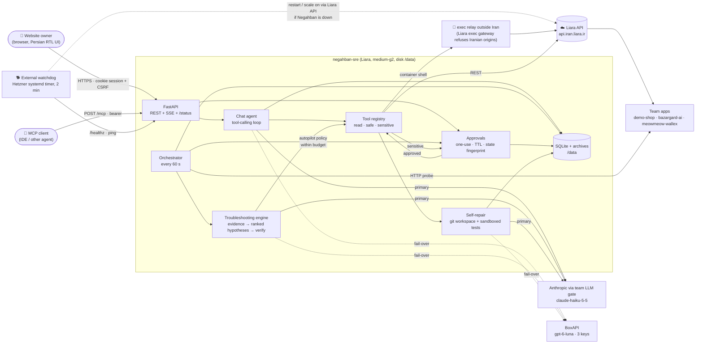

# Architecture

Negahban (نگهبان, "the guardian") is a single FastAPI process. It runs on Liara as the app `negahban-sre`: plan medium-g2, basic bundle, with a 2 GB disk `data` mounted at `/data`. An external watchdog on another server keeps an eye on it.

## Components

| Module | Responsibility |
|---|---|
| `liara.py` | Async Liara client: apps, plans, deploy (upload → release → poll), build logs, rollback, paged logs, events, metrics, disks, domains, DNS. Retries, timeouts and redacted errors. See [LIARA_API.md](LIARA_API.md). |
| `tools.py` | Allow-listed tool registry shared by the chat agent, the orchestrator and the MCP server. Every tool has a JSON schema and a risk class. **read** and **safe** tools (diagnostics, sandboxed tests, patch preparation) run automatically. **sensitive** tools (restart, resize, scale, env, deploy, rollback, create or delete app, domains) never run directly: they create a proposal. |
| `approvals.py` | Proposal cards. Each card shows what will happen, why, the impact (downtime, toman/hour and toman/day cost delta, risk, deploy quota) and a rollback plan. A card is one-use (atomic `pending → executing` claim) and expires after 20 min. It is also bound to a fingerprint of the app state (plan, scale, current release, env key set): if the app changed after the card was made, approval is refused as *stale*. Hard locks (`write_lock`, `env_lock`) cannot be overridden, even by an approval. After execution the card triggers **automatic verification** and posts the result back to the chat and the incident. |
| `diagnose.py` | Troubleshooting engine. **Evidence**: status, health probe, the last 20 min of logs (paged, scoped to the serving release), Docker events, a 30-min CPU/RAM trend against plan limits, releases plus build logs, env keys removed since the last check, and recent operations. **Deterministic hypotheses**, ranked with confidence and evidence, each with fix tools: app off, frozen, failed build (with the missing package), missing env var, OOM from a leak vs. an undersized plan, memory leak trend with minutes-to-limit, CPU saturation, code exception after a release, crash loop, slow responses with idle resources, dependency errors, unreachable. The LLM then writes the plain-Persian summary and adds hypotheses for novel cases (capped at 60 % confidence). **Verification** waits for a real container restart, then judges only the new container: HTTP health, latency, fresh 5xx and tracebacks, the expected plan or env, and memory and CPU. |
| `orchestrator.py` | Always-on loop. Each cycle: probe and metrics sample, new log lines, events, release state. Detectors open **incidents**, and each new incident gets an automatic diagnosis. The **autopilot** policy decides what may run without asking (resize within a plan range and a daily toman budget, restart on crash or leak, rollback, code fix); anything else becomes an approval card. Hysteresis and cooldowns prevent flapping. Incidents resolve automatically after 3 clean cycles, and their stale cards are withdrawn. It scales down after sustained low usage and warns when the team balance runs low. |
| `selffix.py` + `workspace.py` | Self-repair for apps whose source is in a Negahban git workspace (the demo app). The traceback or build failure is mapped to workspace files, and the tests run first to reproduce the failure. The LLM returns full file contents (paths are confined to the workspace, with safe extensions only). The patched copy is tested in a sandbox: a throw-away copy, a scrubbed env with no secrets, `ulimit` CPU, memory and file limits, a timeout, and `unshare -rn` (no network) where the kernel allows it. The diff and test results go on a card. On approval: commit, deploy, verify. If the deploy fails, the commit is reverted. |
| `deployer.py` | Deploys the workspace or archives. Every uploaded tarball is archived with its sha256. Rollback uses Liara's rollback endpoint, or redeploys the previous READY archive. |
| `agent.py` | Chat agent: a tool-calling loop (≤ 10 turns) with live step events ("در حال خواندن لاگ‌ها…") and inline charts, diagrams and logs. Tool outputs are fenced as untrusted data. An abuse detector keeps a sticky per-login score: jailbreak attempts count 2, off-topic requests count 1, and the session is blocked at 5. |
| `llm.py` | Two providers with automatic fail-over. Anthropic (default, `claude-haiku-5-5`) goes through the team's LLM gate. The gate holds the credential and enforces a time window, a kill switch and a rate limit; Negahban only has the gate token. BoxAPI (`gpt-6-luna`) uses 3 keys in round-robin with per-key cooldown. The owner can switch providers at runtime from the dashboard. |
| `analyzer.py` | New-project wizard. Takes a zip (with zip-slip, symlink and size guards) or a public git URL (shallow clone, no hooks). It detects the platform, port, env vars and databases, estimates resources and recommends the smallest plan with 30 % headroom, with live prices. |
| `domains.py` | Custom-domain wizard. Adds the domain via the API and shows the exact ALIAS/CNAME, TXT `liara-challenge` and `_acme-challenge` records, plus the IRNIC nameserver steps. Then it checks the domain and provisions SSL. |
| `mcp.py` | MCP server (protocol 2025-06-18) over stdio and streamable HTTP (`POST /mcp`, bearer token). It exposes the same tools; sensitive calls only create approval cards. |
| `scenarios.py` | Demo fault switches for `demo-shop`: bad release, broken build, missing env var, memory leak, traffic spike (real load generator), slow responses, reset. |
| `templates.py`, `tools_templates.py`, `templates_api.py` | Library of 9 Liara-native, deploy-ready templates: Dockerfile, `liara.json` (port, disks, healthCheck, cron), env schema, plan/bundle and autoscale bounds. Supports CRUD with version history, clone, restore and delete-with-typed-name. Deploy-from-template is an approval card: create the app, deploy, register, apply the autoscale policy, verify. Every app the agent creates through the wizard is saved automatically as a parameterised, secret-free template. |
| `memory.py` | Long-term memory. Owner facts and preferences (`remember` / `recall` tools plus the «حافظه» page). Incident memory: the root cause and fix of every resolved incident is recalled in new diagnoses as evidence ("seen before"). Short summaries of past chat sessions are injected into the agent context. |
| `diag/` | Diagnostics toolkit with 29 tools: container shell (an allow-listed read set, approval for anything else, a hard block-list), HTTP/TLS/DNS probes, a bounded load test, every Liara data source (releases, events, network, disks and files, DBaaS, buckets, billing, DNS), anomaly detection and forecasts, SLO, log intelligence (error groups, request tracing, slow routes, LLM usage), runbooks and web search for unknown errors. It also adds the «ترمینال» and «کاوشگر لاگ» pages. |
| `obs.py`, `resilience.py`, `jobs.py` | Team observability standard. JSON logs with request_id and traceparent; `http.request`, `external.call`, `llm.call`, `job.*` and `circuit.change` events; a global error handler with a request id. Retries with full jitter plus a circuit breaker per upstream (Liara API, each LLM provider). A durable SQLite job queue with retry, dead-letter and replay: approved actions run as jobs. A non-idempotent job interrupted by a restart moves to the dead-letter queue and can only be replayed as a new approval card. |
| `onboarding.py` | Initial setup in one approval card: create the app, deploy (build log streamed live), set env vars (secrets parked privately by reference), verify, keep the default subdomain, save as a template. Includes a pre-check for Liara's one-week balance rule. |
| `alerts.py` | Owner-editable guardrail rules (metric and log pattern; versioned; scope, window, duration, severity, dedup, cooldown, quiet hours; actions notify / wake / autopilot), push ingest, notifications with escalation, channel adapters (Liara mail, Bale, webhook), self-guardrails (LLM spend caps → AI off, automatic-action cap). See [ALERTS.md](ALERTS.md). |
| `control.py` | AI on/off switch; supervised background loops; memory self-check with load shedding; chat back-pressure; hourly and daily state snapshots. See [CONTROL_PLANE.md](CONTROL_PLANE.md). |
| `reports.py` | Daily health report, scheduled at the owner-set Tehran hour and also available from chat: uptime, latency, resources, incidents and fixes, autopilot actions, cost and runway, LLM usage, recommendations. |
| `tools_scaler.py` | Read status of, and propose overrides to, the platform's deterministic horizontal replica controller (`meow-lb`). |
| `static/` | Vanilla-JS Persian RTL dashboard (no framework, CSP `script-src 'self'`). Vendored Vazirmatn font, our own SVG charts, and the vendored Pele renderer for Mermaid diagrams. Updates live over SSE. |
| `deploy/watchdog.py` | The external watchdog ("who watches the watchman"). After 2 failed checks of `/healthz` or a stalled orchestrator, it calls the Liara API: scale on if off, otherwise restart. 15-min cooldown; every decision is logged. |

## Data model (SQLite at `/data/negahban.db`)

| Table | Contents |
|---|---|
| `apps` | Registry: role `demo`, `monitored`, `self` or `off`; URL; health path |
| `samples` | Per-minute CPU, RAM, limits, latency and status. Feeds the sparklines and the autoscale windows |
| `incidents` | Kind, severity, status, diagnosis JSON and timeline |
| `proposals` | Approval cards with fingerprint, expiry, result and verification |
| `audit` | Every action, approval, verification, login and policy change (redacted) |
| `policies` | Per-app autopilot policy and locks |
| `archive` | Deployed source tarballs |
| `chat` | Conversations, including tool steps and attachments |
| `kv` | Cooldowns, env snapshots, abuse scores, the provider toggle, the status page |
| `templates`, `template_versions` | Deploy-ready templates and their versions |
| `memory` | Long-term memory: facts, preferences and incidents |
| `jobs` | Durable job queue (queued, running, succeeded, retrying, dead) |

## Request lifecycle: "the site gives HTTP 500"

1. The orchestrator probe returns HTTP 500 twice, and new log lines contain a traceback. An `errors` incident opens.
2. `diagnose()` collects evidence. The ranked result: *code exception `ZeroDivisionError` in `shop/pricing.py:7`, started after release v3 (90 %)*. Fixes: self-repair, or rollback.
3. Self-repair reproduces the failure (tests: 6 pass, 2 fail), gets a patch from the LLM, re-runs the tests (8 pass) and creates an **approval card with the diff**.
4. The owner clicks *تأیید و اجرا*. The patch is committed, archived, uploaded and released, and Negahban waits until the release is READY.
5. Verification checks HTTP 200, latency, and zero new 5xx or tracebacks from the new release. The card turns ✅ and the incident is resolved. Everything is in the audit log.

## Deployment topology

| Thing | Where |
|---|---|
| `negahban-sre` | Liara, medium-g2 + basic bundle, disk `data` (2 GB). Env vars are set by `deploy/deploy_negahban.py` from 600-mode files on the operator host. |
| `demo-shop` | Liara, small-g2 (autopilot may move it to medium-g2) + standard bundle (50 deploys/day, zero-downtime). |
| Watchdog | Hetzner `negahban-watchdog.timer` (systemd, every 2 min), log `/var/log/negahban-watchdog.log`. |
| Source of truth | `/opt/negahban` (git) on the operator host. |
