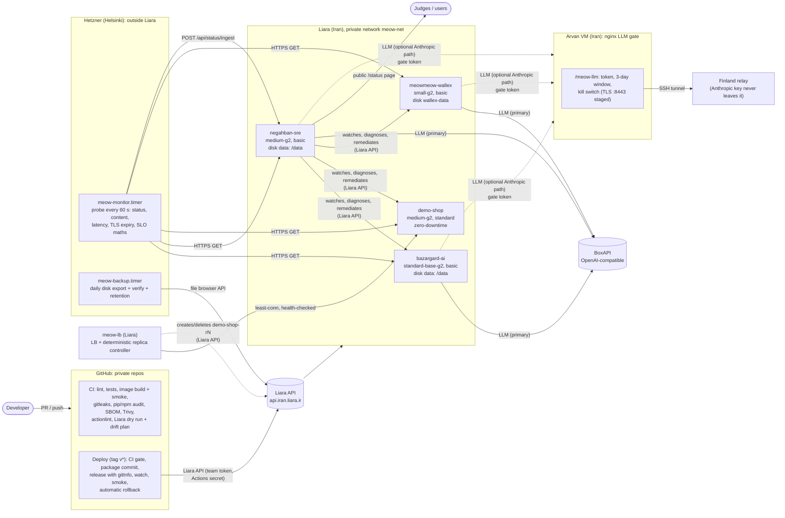

# Platform: how three products are built, shipped and run on Liara

This document describes the shared platform behind the team's three products. It covers the Liara apps, the
GitHub pipelines, infrastructure as code, health checks, backups, monitoring and SLOs, the LLM gate, and
security. Each product repo carries the same platform kit (`infra/`, `.github/`). This repo
(`meowmeow-negahban`) also holds the team-level stack (`infra/liara.yaml`) and the operator jobs (`ops/`).

| Product | Challenge | Liara app | Repo |
|---|---|---|---|
| Bazargard (بازارگرد), in-person shopping assistant | Torob | `bazargard-ai` | `meowmeow-bazargard` |
| Negahban (نگهبان), AI SRE agent, plus its demo target | Liara | `negahban-sre`, `demo-shop` | `meowmeow-negahban` |
| Wallex trading engine and dashboard | Wallex | `meowmeow-wallex` | `meowmeow-wallex` |

## 1. Architecture



The links:

- **Code to production.** GitHub Actions is the only path to a release. CI runs on every push and PR.
  Deploys run from a version tag through `infra/liara_deploy.py`, which talks to the Liara REST API with a
  team token stored as an Actions secret.
- **Runtime.** All four apps run as Docker apps in the private network `meow-net`, which g2 plans require.
  Persistent state lives on Liara disks mounted at `/data`.
- **LLM traffic.** The primary provider is BoxAPI, reached directly. An optional Anthropic path goes through
  the Arvan nginx gate. The gate has its own token, a 3-day validity window and a kill switch. It forwards
  over an SSH tunnel to the Finland relay, which holds the Anthropic key; the key never reaches Liara or Arvan.
- **Watching from outside.** Synthetic probes run from Hetzner (Helsinki), so they catch outages that a
  probe inside Liara would share. Results are pushed to Negahban's public `/status` page.

## 2. Capability status

All operational jobs are built, tested and installed. Per the team's decision they are **not switched on**
during judging, so nothing runs against production unattended. Each row gives the single command that
switches it on.

| Capability | State | Evidence / how to enable |
|---|---|---|
| CI on every push/PR: lint, tests, image build + container smoke, gitleaks (full history), pip-audit / npm audit, SBOM (SPDX + CycloneDX), Trivy, actionlint | **Live** | Actions tab of each repo; badges in each README |
| Read-only Liara preflight on `main`: release dry run + IaC drift plan in the job summary | **Live** | CI job "Liara preflight" |
| Deploy pipeline: tag, release with `gitInfo`, health-check gate, smoke tests, **automatic rollback** | Ready, not enabled | `git tag v1.2.3 && git push origin v1.2.3`, or Actions, then "Deploy to Liara" with `dry_run=false` |
| Infrastructure as code: `plan` | **Live (read-only)** | [`docs/evidence/liara-plan.txt`](evidence/liara-plan.txt): "No changes" against the real account |
| Infrastructure as code: `apply` | Ready, not enabled | `python3 infra/liara_apply.py apply -f infra/liara.yaml` (prompts for `yes`) |
| Liara health checks (`healthCheck` in every release) | Ready, applied by the next pipeline deploy | in `infra/*.yaml`, sent in the release body |
| Zero-downtime deploys | **Live on `demo-shop`** (standard bundle); basic bundle lacks it | set `bundle: standard` + `zeroDowntime: true`, then `plan` / `apply` (cost in §6) |
| Daily disk backups with verification and retention | Ready, not enabled | `systemctl enable --now meow-backup.timer` (Hetzner) |
| Synthetic monitoring from two vantage points, SLOs, public status page | **Live** since 2026-10-22 (timer enabled, every 60 s) | https://negahban-sre.liara.run/status · `python3 ops/monitor/probe.py report` on Hetzner |
| Horizontal scaling + load balancing for stateless apps (deterministic, no LLM; Negahban's AI is an advisor) | **Live**: https://meow-lb.liara.run fronts demo-shop; controller creates and removes `demo-shop-rN` replicas | [SCALING.md](SCALING.md) · `/scaler/status` · `/lb/status` |
| HTTPS for the Arvan LLM gate (Let's Encrypt IP certificate) | Ready, staged; `nginx -t` passed on a copy | `GATE_IP=<gate ip> ops/tls/arvan-gate/enable-tls.sh apply` on the Arvan host |
| Dependabot (pip, npm, Docker, Actions) | **Live** after push | `.github/dependabot.yml` |
| Public hand-over copy without secrets or account details | Ready | `scripts/export-public.sh ../public-copy --denylist ~/deny.txt` |

## 3. Release pipeline (GitHub Actions to Liara)

Two workflows sit in each repo: `.github/workflows/ci.yml` and `.github/workflows/deploy.yml`.

**CI** runs on push, on PR, as a reusable gate and on manual dispatch:

| Job | What it guarantees |
|---|---|
| Lint + tests | The app's own suite. Bazargard: pytest + Vite build. Wallex: ruff + pytest + systemd render. Negahban: make test |
| Platform kit | Strict ruff on `infra/` (and `ops/`), 22 (+11) unit tests against an in-process fake Liara API, manifest schema check, `systemd-analyze verify`, actionlint |
| Secret scan | gitleaks over **every commit**, with a checksum-verified binary. Reviewed false positives are pinned by fingerprint in `.gitleaksignore` |
| Dependency audit | pip-audit per requirements file and npm audit (blocks on critical). Reports go to the job summary |
| Image | Buildx build with GHA cache. A container smoke test checks health JSON, the frontend and that the auth gate returns 401. Also: the **non-root** process check, a check for secret-like files in the image, SBOM in SPDX + CycloneDX, Trivy CRITICAL/HIGH table |
| Liara preflight | `main` only, read-only. Packages the commit, renders the exact release body and checks scale, required env names and the daily deploy quota. Runs `liara_apply.py plan` for drift |

**Deploy** runs on a `v*` tag or a manual run, which defaults to `dry_run=true`. Steps:

1. Reuse the whole CI workflow as a gate (`uses: ./.github/workflows/ci.yml`).
2. `infra/liara_deploy.py deploy`:
   - **Package** exactly the tracked files of the tagged commit, minus `.liaraignore`. The tarball is
     deterministic (same commit gives the same bytes).
   - **Preflight**: the app is running, every env name in `envs.required` exists on Liara, the daily deploy
     quota for the bundle has room, and the source fits the bundle's size limit.
   - **Upload**: `POST /v2/projects/{app}/sources`.
   - **Release**: `POST /v2/projects/{app}/releases` with `type`, `port`, `disks`, `build`, `healthCheck`,
     `gitInfo {commit, branch, message, committedAt, remote, author, tags}` and `message = <tag>`. The body
     never carries `envs`, because on Liara that would replace every variable.
   - **Watch** `GET /v1/releases/{id}` until READY, FAILED, UNHEALTHY, TIMEDOUT or CANCELED. Failed builds
     print the redacted build-log tail.
   - **Smoke test** every check in the manifest: status code, JSON subset, substring and latency budget,
     with retries.
   - **Automatic rollback** if the smoke tests fail, or if an unhealthy release took traffic:
     `POST /v1/releases/{previous}/rollback`, then wait for the new current release and smoke-test it.
   - **Job summary**: a table of each step, the release id, the previous release, the commit link, the app
     URL and the Liara console link.
3. The exit code maps to a clear annotation:

   | Exit code | Meaning |
   |---|---|
   | 0 | Deployed |
   | 1 | Failed before traffic moved |
   | 2 | Rolled back automatically |
   | 3 | Rollback failed: page a human (runbook R1) |
   | 4 | Refused by preflight |

`concurrency: deploy-<app>` with `cancel-in-progress: false` guarantees one release per app at a time, and
none is interrupted halfway. The `production` environment scopes the run and shows the app URL on the run page.

Basic bundles allow 20 deploys a day and standard 50. The pipeline counts today's releases and refuses
before uploading when the quota is used up.

## 4. Infrastructure as code

- **`infra/liara.yaml`** (this repo) is the team-level stack. It declares the network, budget floor and all
  four apps.
- **`infra/liara.app.yaml`** in the Bazargard and Wallex repos declares that one app. The deploy pipeline
  reads it too.
- **What each app declares:**
  - plan and bundle, network, zero-downtime, read-only root filesystem, running state
  - disks (size, mount, backup policy)
  - required and optional env var **names**
  - health check, smoke checks, SLO, and scaling bounds
- **No env values.** Values come from the secret store (Liara itself, or `LIARA_ENV__<KEY>` at apply time).
  CI rejects a manifest that contains them.

```bash
export LIARA_API_TOKEN=... LIARA_TEAM_ID=...       # or: set -a; . /etc/meow-platform/liara.env; set +a
python3 infra/liara_apply.py plan  -f infra/liara.yaml           # read-only; exit 0 = in sync, 2 = drift, 1 = invalid
python3 infra/liara_apply.py plan  -f infra/liara.yaml --json    # machine-readable
python3 infra/liara_apply.py apply -f infra/liara.yaml           # shows the plan, asks for "yes"
python3 infra/liara_apply.py apply -f infra/liara.yaml --allow-delete   # only way anything is removed
```

**What `plan` checks.** It diffs plan, bundle, zero-downtime, read-only root filesystem, scale, disks
(create, grow, and a warning on shrink) and missing env names. It **validates the manifest against the
bundle's real capabilities** from `/v1/me`. For example, asking for zero-downtime on the basic bundle is an
error, not a silent no-op. It also reports cost (current vs desired toman/hour) and the **credit runway**
(balance ÷ run-rate) against `budget.minRunwayHours`. Undeclared apps, disks and env vars are reported,
never touched.

**Scaling.** Liara has no horizontal scaling or autoscaling API; scale is 0 or 1. The `scaling` block
records vertical bounds (`min`/`max` plan and triggers). Negahban and runbook R2 act within those bounds
with `POST /v1/projects/{app}/resize`.

Evidence: [`docs/evidence/liara-plan.txt`](evidence/liara-plan.txt) is the read-only plan against the live
account on 2026-10-22, with the result "No changes".

## 5. Health checks and zero downtime

Every release body carries a Docker health check from the manifest. The command uses the exec form
`["CMD","python","-c","urllib.request.urlopen(...)"]`, because two images lack curl and the string form
would be split on spaces.

| App | Health check (liveness) | Readiness (smoke) | startPeriod |
|---|---|---|---|
| bazargard-ai | `/api/health` | `/api/health` (catalogue ready) + `/api/ready` + `/` | 60 s |
| negahban-sre | `/healthz` | `/healthz` + `/` | 30 s |
| demo-shop | `/healthz` | `/healthz` | 15 s |
| meowmeow-wallex | `/healthz` | `/healthz` + `/` must be **401** (auth gate) | 30 s |

**Units: seconds** (verified 2026-10-23). The Liara CLI prompt (`interval(ms)`) and docs.liara.ir say
milliseconds, but the API rejects anything else. Release validation requires `interval >= 30`,
`1 <= timeout <= 10000`, `retries <= 10` and `startPeriod <= 3000`, so a millisecond value such as
`startPeriod: 30000` is refused. The manifests therefore use `interval: 30`, `timeout: 10`, `retries: 3` and
`startPeriod: 15–60`. meow-lb runs with this health check live.

**Behaviour** (Liara docs):

- Traffic moves to a new release only after its health check passes. Otherwise the release becomes
  `UNHEALTHY` and the previous one keeps serving. The pipeline treats `UNHEALTHY` as a failure and rolls
  back explicitly if the unhealthy release took traffic.
- At runtime, a failing check makes Liara restart the container.

**Zero-downtime** needs the standard or pro bundle (from `/v1/me` → `projectBundlePlans[*].zeroDowntime`).
`demo-shop` runs standard with zero-downtime on. The three basic-bundle apps get the health-check gate and
automatic rollback but have a short cutover gap. Upgrading is a manifest edit plus `apply`; costs are in §6.

## 6. Cost and capacity

Prices come from the live `/v1/usage-report` on 2026-10-22, in toman per hour.

| App | Plan + bundle | Hourly | Upgrade to standard bundle (zero-downtime + daily native backups) |
|---|---|---|---|
| bazargard-ai | standard-base-g2 + basic | 3,194 | +903/h |
| negahban-sre | medium-g2 + basic | 1,806 | +486/h |
| demo-shop | medium-g2 + standard | 2,292 | (already standard) |
| meowmeow-wallex | small-g2 + basic | 1,042 | +278/h |
| **Total** | | **8,333/h (about 6.0M per 30 days)** | +1,667/h for all three |

The balance on 2026-10-22 was about 1.97M toman, which is roughly **237 h (9.9 days) of runway**.
`liara_apply.py plan` prints the runway on every run, and CI shows it in the drift summary.

## 7. Monitoring, SLOs and the status page

**Probe.** `ops/monitor/probe.py` runs as `meow-monitor.timer`, every 60 s, on Hetzner in Helsinki. It
probes all apps in parallel, sending one HTTPS GET per app to the SLO probe path from the manifest, and
records:

- the status code
- a content check (the same JSON subset or substring as the smoke tests)
- latency from TCP connect to the last byte, with DNS timed separately and **excluded** (resolver hiccups on
  the probe host are not app latency)
- days until the TLS certificate expires, read from the same connection

Hostnames resolve IPv4 first, because AAAA lookups on the probe host stalled for about 1.8 s.

**Two vantage points, and rules against false outages.** One probe host on an international link can lose
the path to Iran while every app is healthy. That happened at 18:19-18:20 UTC on 2026-10-22: all apps timed
out from Helsinki at once, and availability dropped to 97.8 %. The monitor therefore applies three rules:

1. **Retry.** A failed external probe is retried once after 5 s before it counts.
2. **Vantage check.** If *every* app fails from Helsinki in the same run, the run is recorded as
   `vantage_unreachable` (a probe-side or network problem). It appears under "Probe-side notes" on the status
   page and is **not counted** against app availability. No alerts or state changes come from it.
3. **Second vantage inside Iran.** Negahban's orchestrator already probes every app from inside Liara every
   60 s, and the monitor reads its latest results (`GET /api/status/vantage`, bearer token; results older than
   180 s count as unknown). Each app gets a verdict:

   | External (Helsinki) | In Liara (Negahban) | Verdict | Counted as |
   |---|---|---|---|
   | ok | any | `up` | available |
   | fail | ok | `degraded_external_only` | available (shown separately: users in Iran are served) |
   | fail | fail | `down` | unavailable |
   | fail | unknown | `down`, or `vantage_unreachable` when every app failed | unavailable / not counted |

The status page shows both vantages for each app. Raw results from both vantages are kept on every row.
Availability is computed from the verdicts. Rows recorded before these rules keep their raw result, except
runs where every app failed: rule 2 reclassifies those, which includes the 18:20 blip.

**State and outputs.** State lives in SQLite (`/var/lib/meow-monitor/probes.db`, 35-day retention). Each
run renders three outputs:

- `status.json`: the agreed schema, plus 1 h / 24 h / 7 d / 30 d availability, p95, error budget and
  incidents
- `status.html`: a static, self-contained page
- `badge-<app>.json`: shields.io endpoint badges

`status.json` is POSTed to Negahban (`POST /api/status/ingest`, bearer token). Negahban renders the public,
read-only **https://negahban-sre.liara.run/status**.

**SLOs**, over a 30-day rolling window measured from outside Liara:

| SLI | Target | Notes |
|---|---|---|
| Availability (good probes ÷ all probes) | **99.5 %** (demo-shop 99.0 %, chaos target) | about 3.6 h of error budget per 30 days |
| Latency p95 (connect to last byte, successful probes, 24 h) | **< 1,500 ms** | The validation run on 2026-10-22 measured 400-520 ms from Helsinki |

**Error-budget policy.**

- While more than 50 % of the budget remains, deploy freely.
- Below 50 %, deploy only with a reviewer.
- When the budget is exhausted, freeze feature deploys and allow only fixes and rollbacks until the
  30-day availability is back over target.

**Alerts.**

- An app goes **DOWN** after 2 consecutive `down` verdicts: the external probe failed after its retry, and the
  in-Liara probe failed too or was unavailable. That is about 2 minutes. `vantage_unreachable` runs never
  change state.
- It goes **UP** on the first success. Transitions are logged as JSON (`event: app.down` / `app.up`) and
  sent to `ALERT_WEBHOOK_URL` when one is set.
- TLS expiry under 14 days logs `tls.expiring`.
- The probe exits 1 while any app is down, which systemd records as data, not as a unit failure.

**Validation.**

- Before enabling: one manual run recorded all four apps UP (p95 504 / 519 / 466 / 458 ms, TLS 58.6 days).
- The timer was enabled on 2026-10-22.
- The two-vantage rules have 7 dedicated unit tests: retry, all-fail classification, degraded-external-only,
  both vantages agreeing, stale internal data, and the history migration.

See [`docs/evidence/PLATFORM_EVIDENCE.md`](evidence/PLATFORM_EVIDENCE.md).

**Logging standard.** Apps log structured JSON with request IDs: one object per line with `ts`, `level`,
`app`, `release`, `event`, `request_id` and so on. The standard is in the team brief and owned by each app.
Negahban reads the logs through `GET /v2/projects/{app}/logs`.

## 8. Backups and restore

**Why two mechanisms.** Liara's native disk backups exist only on standard (daily, 7 kept) and pro bundles.
`/v1/me` reports `availableBackupInterval: []` for basic, which three of our four apps use. So
`ops/backup/liara_backup.py` has two paths:

- **native**: `create`, `list` and `download` through `/v1/projects/{id}/disks/{disk}/backups`, wherever the
  bundle has it.
- **export** (every bundle): walks the disk through the Liara **file browser API** (`list` → `createLink` →
  `serve`) and writes `app--disk--<UTC>.tar.gz` (mode 600) to Hetzner. That is a second provider in a second
  country.

**What each archive carries.** `MANIFEST.json` lists size and sha256 per file. **Verification runs right
after every backup:**

- the tar is checked for path traversal and symlinks
- every file is re-hashed against the manifest
- every SQLite file must pass `PRAGMA integrity_check`
- every JSON file must parse

**Retention.** The newest 7 archives are kept, plus the newest of each of the last 4 ISO weeks.

**Exclusions.** The manifest names files that need no backup. Bazargard's 430 MB `catalog.db` is
reproducible: it is seeded from the domestic mirror and checked by `CATALOG_SHA256`.

**Schedule.** `meow-backup.timer` runs daily at 02:30 UTC with up to 10 min of random delay and
`Persistent=true`. The units run as `DynamicUser` and get the Liara token through `LoadCredential=`.
`systemd-analyze security` rates the exposure **1.2 OK**.

**Restore procedure (tested by the unit suite against a fake Liara; follow it exactly):**

```bash
# on Hetzner
set -a; . /etc/meow-platform/liara.env; set +a; cd /opt/meow-platform
ls -1t /var/lib/private/meow-backup/bazargard-ai/ | head          # pick an archive
A=/var/lib/private/meow-backup/bazargard-ai/bazargard-ai--data--20261023T023012Z.tar.gz
python3 ops/backup/liara_backup.py verify "$A"                    # must print VERIFIED
# 1. non-destructive: upload into data/restore-<ts>/ on the live disk (dry run first, then --yes)
python3 ops/backup/liara_backup.py restore "$A" --app bazargard-ai --disk data
python3 ops/backup/liara_backup.py restore "$A" --app bazargard-ai --disk data --yes
# 2. swap in with the app stopped (SQLite must not be open while files move)
#    scale 0 -> move files from /data/restore-<ts>/ over /data/ (Liara file browser or app shell) -> scale 1
# 3. verify: smoke tests + the app's own data check
python3 infra/liara_deploy.py smoke --manifest infra/liara.yaml --app bazargard-ai
# Native (standard/pro bundles only):
python3 ops/backup/liara_backup.py native list --app demo-shop --disk <disk>
python3 ops/backup/liara_backup.py restore-native --app demo-shop --disk <disk> --name <backup> --yes
```

`liara_backup.py restore` refuses an archive that fails verification. `--in-place` overwrites and needs
`--yes`. Copying a live SQLite file can catch a write in flight; the post-backup verification detects it
and the retention keeps older generations. Apps that need point-in-time consistency should write
`VACUUM INTO '/data/snapshot.db'` before 02:30.

## 9. Security posture

**Secrets**

- Secrets exist only in Liara env vars, in GitHub Actions secrets (`LIARA_API_TOKEN`, `LIARA_TEAM_ID`,
  sealed-box encrypted) and in 0600 root-only files on the operator hosts.
- The systemd jobs get secrets through `LoadCredential=` (only the 3 needed variables) and never through
  the environment of a shell.
- Every tool passes output through `redact()`, which masks the configured tokens, JWTs and bearer values.
  Unit tests check that a seeded token never appears in output.

**Supply chain**

- Third-party actions are pinned to commit SHAs.
- gitleaks is downloaded with checksum verification.
- Dependencies are pinned in `requirements*.txt` and `package-lock.json`.
- Each image gets an SBOM.
- pip-audit, npm audit, Trivy and Dependabot cover known vulnerabilities.
- Finding on 2026-10-22: Negahban's `fastapi==0.115.6` pulls `starlette 0.41.3` with 6 advisories. The owner
  has been notified, and CI flags it until it is bumped.

**Containers (reviewed 2026-10-22 on locally built images)**

| Image | Size | Process user | Secret-like files |
|---|---|---|---|
| bazargard | 220 MB | uid 10001 via `setpriv` | none |
| negahban | 387 MB | uid 1000 | none |
| demo-shop | 200 MB | **root** (demo target; flagged as a CI warning) | none |
| meowmeow-wallex | 215 MB | **root** (fix proposed to the owner; CI warning until merged) | none |

**Network**

- Liara apps talk over the private network `meow-net`.
- The LLM gate checks a token, enforces a 3-day window and has a kill switch
  (`sudo touch /etc/nginx/meow-llm.disabled`, no reload needed).
- HTTPS for the gate is staged: a Let's Encrypt **short-lived IP-address certificate**, the same mechanism
  as the Hetzner host's certificate (certbot ≥ 5, `--preferred-profile shortlived --ip-address`, webroot,
  deploy hook `nginx -t && reload`).
- The gate uses port 8443 because port 443 on Arvan belongs to the stream relay.
- `enable-tls.sh` has these modes:
  - `preflight`: read-only checks
  - `stage-test`: full `nginx -t` on a copy (passed)
  - `apply`: backup, edit, `nginx -t`, reload, then **compare the status code of every public route on the
    host with a pre-change snapshot** and restore automatically on any difference
  - `rollback`: restore the backup
- The plain-HTTP gate path stays until every app has switched.

**Repo hygiene**

- `SECURITY.md` (private advisories), `CODEOWNERS`, issue templates (bug and incident/postmortem), a PR
  template with a rollout/rollback checklist, and Dependabot.
- `scripts/export-public.sh` produces a single-commit public copy. It runs gitleaks, a denylist kept
  outside git, and checks for credential patterns, public IPs and object ids.
- Dependabot alerts and automated security fixes are enabled on all three repos.
- **Branch protection is blocked by the GitHub plan**, not by permissions: on GitHub Free, private repos
  have no protection or rulesets (API: *"Upgrade to GitHub Pro or make this repository public"*). Once a
  repo is public, run:

  ```bash
  gh api -X PUT repos/<owner>/<repo>/branches/main/protection --input - <<'JSON'
  {"required_status_checks": {"strict": true, "contexts": ["Secret scan (gitleaks, full history)", "Platform kit (deploy / IaC tooling)"]},
   "enforce_admins": false, "required_pull_request_reviews": {"required_approving_review_count": 1},
   "restrictions": null, "allow_force_pushes": false, "allow_deletions": false}
  JSON
  ```

## 10. Runbooks (top failure modes)

All commands assume the following. On Hetzner, use the installed copy: `cd /opt/meow-platform` and
`set -a; . /etc/meow-platform/liara.env; set +a`. From a checkout, use the repo root with
`LIARA_API_TOKEN`/`LIARA_TEAM_ID` exported.
`API="https://api.iran.liara.ir"; T="teamID=$LIARA_TEAM_ID"; H="Authorization: Bearer $LIARA_API_TOKEN"`; `GATE_IP` is the Arvan host's public IPv4 (in the private access guide).

### R1. A release is bad (errors after deploy, smoke failed, rollback exit 3)

```bash
python3 infra/liara_deploy.py status   --manifest infra/liara.yaml --app <app>     # * marks the current release
python3 infra/liara_deploy.py rollback --manifest infra/liara.yaml --app <app>     # newest READY before current
python3 infra/liara_deploy.py rollback --manifest infra/liara.yaml --app <app> --to <releaseId>
python3 infra/liara_deploy.py smoke    --manifest infra/liara.yaml --app <app>
```

If the rollback API refuses (`428 rollback_not_supported`), redeploy the previous tag:
Actions → "Deploy to Liara" → run on tag `v<previous>` with `dry_run=false`.

### R2. App down or crash-looping (probe DOWN, 502/503)

```bash
curl -s -H "$H" "$API/v1/projects/<app>/events?start=$(( $(date +%s) - 3600 ))&end=$(date +%s)&$T" | python3 -m json.tool | grep -E '"action"|oom|die'
curl -s -H "$H" "$API/v2/projects/<app>/logs?start=$(( $(date +%s) - 900 ))&$T" | python3 -c 'import sys,json;[print(v[1][:300]) for g in json.load(sys.stdin)["data"] for v in g["values"]]' | tail -50
curl -s -H "$H" "$API/v1/projects/<app>/metrics/summary?$T" | python3 -m json.tool       # cpu / memory / disk now
curl -s -X POST -H "$H" "$API/v1/projects/<app>/actions/restart?$T"                       # transient: restart
```

If you see `oom` events or memory above 85 %, raise `plan` in the manifest within `scaling.max`, then run
`python3 infra/liara_apply.py plan`, then `apply`. Expect about 20 s of 502 during the resize. If the crash
started with a release, go to R1.

### R3. Configuration change broke the app (missing/wrong env var)

```bash
python3 infra/liara_apply.py plan -f infra/liara.yaml --app <app>     # lists missing required env NAMES
python3 infra/liara_deploy.py status --manifest infra/liara.yaml --app <app>   # ENV_UPDATE releases are listed
python3 infra/liara_deploy.py rollback --manifest infra/liara.yaml --app <app> --to <last good ENV_UPDATE/DEPLOY id>
LIARA_ENV__<KEY>='<value from the vault>' python3 infra/liara_apply.py apply -f infra/liara.yaml --app <app>
```

`update-envs` replaces **all** variables. The tooling always sends existing + new; never hand-craft a
partial list.

### R4. LLM degraded (timeouts, 401/429 from BoxAPI, gate errors)

- The apps rotate BoxAPI keys and fail over on 401/402/403/429/5xx. Check the logs for `external.call`
  with `circuit: open` (R2 log command, `search=llm`).
- To switch provider: set `LLM_PROVIDER=boxapi|anthropic` on the app (R3 apply flow).
- Anthropic path (Arvan gate):
  - Health: `curl -s -o /dev/null -w '%{http_code}' http://$GATE_IP/meow-llm/health`. 401 without a
    token is healthy routing.
  - Emergency stop: `ssh ubuntu@$GATE_IP sudo touch /etc/nginx/meow-llm.disabled` (503 at once).
    Re-enable with `sudo rm` on the same file.

### R5. Disk full or data damaged

```bash
curl -s -H "$H" "$API/v1/projects/<app>/metrics/summary?$T" | python3 -c 'import sys,json;print(json.load(sys.stdin)["disksUsage"])'
```

- **Full:** raise `sizeGB` in the manifest, then `plan` / `apply`. This calls
  `POST /v1/projects/<app>/disks/<disk>/resize`; disks can only grow.
- **Damaged:** stop writes with `POST .../actions/scale {"scale":0}`, then follow the restore procedure in
  §8, then `scale 1`, then smoke tests.

### R6. Credit running out or app frozen (`frozen_project`)

```bash
python3 infra/liara_apply.py plan -f infra/liara.yaml | tail -3          # balance + runway in hours
curl -s -X POST -H "$H" "$API/v1/projects/<app>/unfreeze?$T"             # after topping up
```

To stretch the runway, stop non-essential apps. `demo-shop` is the first candidate: set `running: false`,
then `apply`. Downgrade plans within `scaling.min`.

### R7. TLS certificate close to expiry (probe `tls.expiring`)

- Liara apps (`*.liara.run`): Liara renews the certificate. Open a Liara ticket if it is under 7 days.
- Arvan gate (after TLS is enabled): run `sudo /opt/certbot/bin/certbot renew` and
  `systemctl status meow-certbot.timer`, then `./enable-tls.sh verify`.

## 11. On-call checklist

1. **Status:** check https://negahban-sre.liara.run/status (or `python3 ops/monitor/probe.py report` on
   Hetzner) and the latest CI and Deploy runs.
2. **Which app, since when:** read `incidents_7d` in `status.json`, and the release history with
   `liara_deploy.py status`. A deploy in the last hour points to R1 first.
3. **Mitigate before you debug:**
   - Bad release: roll back (R1).
   - Crash: restart (R2).
   - Bad config: roll back the ENV_UPDATE (R3).
   - Provider down: switch provider or use the kill switch (R4).
4. **Verify:** run `liara_deploy.py smoke` and confirm the probe is UP again. Error-budget burn is visible on
   the status page.
5. **Record:** open an *Incident / postmortem* issue (template) with the timeline in UTC, the cause and the
   action items.
6. **Daily (2 min):**
   - CI badges are green.
   - `liara_apply.py plan` shows no drift and runway is above 72 h.
   - Backups: `/var/lib/private/meow-backup/last-run.json` has `failures: 0` (once enabled).
   - Dependabot PRs are triaged.

## 12. Why this is production-grade

- **One path to production, fully gated.** Nothing reaches Liara without lint, tests, a container smoke
  test, a secret scan over all history, dependency and image audits and an SBOM. The deploy reuses the
  exact CI workflow as its gate.
- **Releases are reproducible and traceable.** The deterministic tarball of the tagged commit and the
  `gitInfo` on every Liara release tie each running container to a commit, author and tag.
- **Bad releases do not stick.**
  - The health check gates the traffic switch.
  - Smoke tests check real behaviour, including that the Wallex dashboard stays behind auth.
  - Rollback is automatic through Liara's rollback API, with explicit exit codes and job summaries.
- **Infrastructure is declared, diffed and validated against the real account.** That includes bundle
  capabilities, costs and credit runway. `apply` is idempotent, asks for approval and never deletes without
  a flag.
- **Failure is observed from outside the failure domain.** Probes run from another provider and country,
  with SLOs, error budgets, incident detection and a public status page. Backups also leave Liara and are
  integrity-verified every time.
- **Least privilege everywhere.**
  - SHA-pinned actions with `contents: read`.
  - Credentials handed to `DynamicUser` units through `LoadCredential=` (systemd exposure 1.2).
  - Non-root containers where the image allows it.
  - Redaction in every tool.
  - Env values are never in git or in release bodies.
- **Honest about the platform's limits, with the numbers.**
  - Basic bundles have no zero-downtime and no native backups, so the platform adds health gates,
    rollback and off-platform backups, and states the upgrade cost.
  - Liara has no autoscaling, so the platform records explicit vertical bounds and runbooks.
  - The health-check unit is documented as needing confirmation on the first enabled deploy.
- **Tested like product code.** 33 unit tests cover:
  - the deploy, rollback and refusal paths
  - IaC plan and apply, including no-delete
  - redaction
  - backup export, verify, corruption and path-traversal detection, retention and restore
  - probe state transitions, SLO maths and HTML escaping

  They run against in-process fakes of the Liara API and file browser on every push.

## 13. Release to the public repositories

The public repositories (`bazargard`, `negahban`, `wallex-ai-trader`) follow the build host's source of record
automatically. A publish job runs on the operator host every 30 minutes (`meow-publish.timer`) and on demand
(`publish.py <project>`). For each project it does the following:

1. **Merge the source of record into the working repository.** A three-way merge is used: the base is the source
   at the last sync, so the repository's own platform and doc files are kept.
   - Bazargard comes from its application tree.
   - Negahban comes from its git `HEAD`.
   - Wallex comes from the `liara-live` branch, with a path mapping (for example `docs/wallex-arena.md` →
     `docs/components/arena.md`).
   - A merge conflict stops the run for a human to resolve.
2. **Export a public copy.** Deployment-specific values (server addresses, absolute host paths, account
   identifiers, contact addresses) are replaced by placeholders. Workflows get public-repository guards: Liara
   jobs run only in the canonical repository and never for pull requests.
3. **Gates. Any finding stops the publish**, and the finding is logged:
   - gitleaks over the tree;
   - a deny list of private values (hosts, identifiers, addresses);
   - checks for absolute host paths and for files that must not ship.
4. **Pull request.** If the exported tree differs from the public `main`, the job makes one commit with a plain
   change summary, pushes it on a branch, opens a pull request and waits for the **required checks** (the same CI
   as here). It then **rebase-merges**, which keeps linear history and the commit author, and deletes the branch.
   Branch protection is never relaxed.
5. **Verify.** The tree of the merged commit must equal the exported tree. The job waits for CI on `main` and
   records the result.

If nothing changed, the job commits nothing. Logs and the last result are kept on the operator host
(`/opt/<ops>/public/logs`). The job runs once more right after a scheduled production deploy, so the public
repository follows the release within minutes.

**Repository hygiene.** Presentation material (video scripts, playbooks, narration, screenshots and recordings) is
kept outside the repositories: the merge step drops it, `.gitignore` excludes it, and both the working and the
public repository are gated against it. Every commit uses the team identity and the team message format, with no
trailers; a `commit-msg` hook in the working copies and a message check in the job enforce it. Review-bot comments
are removed from pull requests after each run.
