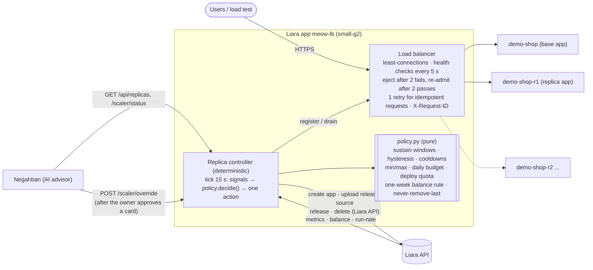

# Scaling on Liara: deterministic horizontal scaling and load balancing

**Short answer to "why does scaling need AI?"** It doesn't. Scaling decisions here come from a small rule set
(`scaler/meowlb/policy.py`): pure functions, no I/O, no LLM. The rules are tested with simulated metrics and keep
working with the LLM switched off. Negahban's AI is an *advisor* on top. It can read the controller's state,
explain it in Persian, and request a target through an owner-approved card. The controller applies the same
guards to an AI request as to its own decisions.

| | |
|---|---|
| Load balancer | **https://meow-lb.liara.run**, a Liara app (small-g2, basic) in front of `demo-shop` and its replicas |
| Controller | runs inside the same process; one deterministic tick every 15 s |
| Code | `scaler/` (`meowlb/policy.py`, `lb.py`, `controller.py`, `liara.py`, `app.py`), with 25 unit tests run in the Docker build and in CI |
| Read-only views | `/lb/status`, `/scaler/status`, `/scaler/audit` (public, no secrets) |
| Control | `POST /scaler/override` and `POST /lb/backends` (Bearer `SCALER_ADMIN_TOKEN`); Negahban reads `/api/replicas` (Bearer `SCALER_READ_TOKEN`) |

## 1. Why a custom layer: what Liara offers

- **No native replicas, no autoscaling.** `POST /v1/projects/{app}/actions/scale` accepts only `0` or `1`. There is
  no replica count, horizontal scaling API or load balancer product for apps.
- **Vertical resize exists.** `POST /v1/projects/{app}/resize {planID}` changes the hardware plan, with about 20 s of
  502s. Single-instance apps keep using it, within the `scaling.min..max` bounds in `infra/liara.yaml`.
- **A replica must therefore be a separate app.** The controller creates `demo-shop-r1`, `demo-shop-r2` and so on
  from the base app's *current release source* and env, and puts them behind its own load balancer.
- **Each replica app has its own quota.** It gets the bundle's daily deploy quota (basic: 20/day), its own hourly
  bill, and its own `*.liara.run` hostname.
- **The one-week balance rule.** Liara refuses to create an app (`429 "You need enough balance to cover one week's
  cost"`) unless the balance covers 168 h of the whole account's run-rate including the new app. We discovered this
  live and turned it into a guard (§4).
- **IaaS VMs** bill a 24 h minimum. Auto-provisioning VMs for spikes would cost a full day per spike, so VM scaling
  is **off by default**.

## 2. Architecture



**Who decides what**

| Layer | Decides | Needs an LLM? | Can be overridden by |
|---|---|---|---|
| `policy.decide()` | scale out, scale in, or nothing, one step at a time | **no** | an override (time-bounded), still guarded |
| Controller | how to act: create/deploy/register, drain/delete, clean up on failure | no | nobody; it is mechanical |
| Load balancer | which healthy backend gets each request | no | `POST /lb/backends` (manual add/remove) |
| Negahban AI | explains state, proposes `hold`, `desired=N` or bounds | yes (advisory) | the owner approves or rejects the card |

## 3. The control loop

Every 15 s the controller runs four steps.

1. **Signals**:
   - from the load balancer: requests per second over the last 60 s, rps per healthy backend, p95 latency, and the
     number of healthy backends;
   - every 60 s, from Liara: the CPU and RAM of every instance as a fraction of its plan (cores and bytes from
     `/metrics/summary`, plan sizes from `/v1/me`);
   - every 5 min: the balance and the account run-rate (`/v1/usage-report`).
2. **Timers**: how long the signals have been *above* the scale-out band and how long *below* the scale-in band.
   The two bands do not overlap. In between, the dead band resets both timers (hysteresis), so a load hovering
   near a threshold never makes replicas flap.
3. **Decision** (`decide()`), in this order:
   1. disabled
   2. operation in progress
   3. an active override: clamped to min/max and guarded
   4. an operator hold
   5. below min → repair
   6. sustained breach → scale out one step
   7. sustained calm → scale in one step
4. **Action** (asynchronous, one at a time):
   - **Scale out:** create the app `demo-shop-rN` (replica plan and bundle, the base app's private network), then:
     1. `POST /v2/releases/{current}/source` to get the base app's current source, then download it;
     2. upload it to the replica;
     3. release it with the base app's env, the same port and `gitInfo`-style message;
     4. wait for `READY`;
     5. register it in the load balancer, which keeps it out of rotation until 2 health checks pass;
     6. wait until it is healthy.

     **Any failure deletes the half-built app**, so nothing is left billing.
   - **Scale in:** mark the newest replica *draining* (no new requests), wait for its in-flight requests (up to 30 s),
     deregister it and delete the app. The base app is never deleted. The name must match `^<app>-r\d+$`, and the
     last healthy backend is never removed.

**Stateless by design.** The load balancer keeps no state of its own. On restart the controller adopts the existing
`demo-shop-rN` apps from Liara, which is the source of truth. The audit trail is in memory (the last 500 entries)
and is also written as JSON lines to Liara's log store (`event: scaler.audit` / `scaler.decision`).

## 4. Policy and guards

Live policy for demo-shop (`scaler/deploy_meowlb.py`). The defaults are in `policy.DEFAULT_POLICY`.

| Setting | Value | Why |
|---|---|---|
| min / max instances | 1 / 3 | base app + up to 2 replicas |
| scale out when | rps/backend > 5 **or** p95 > 2000 ms, sustained 60 s | request pressure, as seen by the load balancer |
| scale in when | rps/backend < 1 **and** p95 < 800 ms, sustained 120 s | a wide gap to the scale-out band (hysteresis) |
| CPU/RAM triggers for demo-shop | **off** | demo-shop is Negahban's chaos target. Its CPU/RAM leak scenarios are fixed by a restart, not by replicas. In the first live hour a CPU ramp (148–189 % of its plan) triggered a replica, so CPU/RAM triggers were switched off for it. They remain available for other apps. |
| cooldowns | 120 s after any action | let a new replica take traffic before judging again |
| daily budget | 30,000 toman of replica spend | about 28 replica-hours/day at 1,042 toman/h |
| deploy quota | 20/day per replica app (basic) | counted per name. A name that hit its quota is skipped |
| **one-week balance rule** | balance ≥ 168 h × (account run-rate + new replica) | Liara's own precondition for creating an app, checked *before* calling the API |
| never-remove-last | at least one other healthy backend | checked in the policy **and** again in the controller |
| unhealthy replica | reported after 10 min | it never takes traffic while unhealthy |
| a replica is not possible | audited once per load episode, in English and Persian | the one-week rule (`refused`), a Liara 429 (`refused`, then a 15 min back-off), the budget, the quota, or the max bound (`at_max`) |
| vertical fallback (optional, **off**) | `vertical.enabled`, plan ladder `small-g2 → medium-g2` | when on, a blocked scale-out resizes the base app one plan up instead, verified (Liara reports the new plan and the health check passes), and steps it back down after sustained calm. It only steps down what it stepped up. It is off for demo-shop because **Negahban's autopilot owns vertical resizes there: exactly one actor may resize an app** |

**Overrides (AI or human)** use `POST /scaler/override {action, desired?, min?, max?, minutes?, reason, actor}`.

| Action | Effect |
|---|---|
| `desired` / `scale_out` / `scale_in` | Sets a target for N minutes (default 30, at most 240). The target is clamped to min/max and still subject to the budget, quota, balance and never-remove-last guards. |
| `hold` | Pauses automatic actions. |
| `resume` | Clears holds and overrides. |
| `set_bounds` | Changes min/max, with 1 ≤ min ≤ max ≤ `hard_max` (5). |
| `demo_mode` / `demo_off` | Short timings for a recording (§9), for at most 180 min. They revert by themselves. |
| `dry_run` / `dry_off` | Decisions are audited as `would_scale_out` and so on; nothing is created, deleted or resized. At most 120 min. |

Every override is audited with the actor (`negahban-ai` or `human`) and the reason.

**Which apps scale horizontally** (`/scaler/status → registry`):

| App | Mode | Reason |
|---|---|---|
| demo-shop | horizontal | stateless: no disk |
| bazargard-ai | vertical | persistent disk + SQLite (catalogue, user memory): exactly one writer |
| negahban-sre | vertical | SQLite state on its disk and a single orchestrator loop |
| meowmeow-wallex | vertical | one trading engine per exchange account (two replicas would double the orders) |

## 5. Load balancer details

- **Strategy.** Least connections, with round-robin among ties (`LB_STRATEGY=round_robin` is available). Optional
  cookie stickiness (`LB_STICKY=1`, cookie `meowlb`).
- **Health.** `GET <backend>/healthz` every 5 s with a 3 s timeout. A backend is ejected after 2 failures and
  re-admitted after 2 successes. New backends start out of rotation.
- **Passive health (outlier detection), since 1.0.3.** A backend whose real requests are at least 50 % 5xx (20 or
  more requests in 30 s) is ejected for 30 s, even while its `/healthz` passes. The last healthy backend is never
  ejected. Each ejection logs `lb.outlier_ejected`.
- **Retries.** One retry on another backend for idempotent methods (GET, HEAD, OPTIONS, PUT, DELETE) on connection
  errors and 502/503/504. POST is never retried. With no healthy backend the answer is `503` with `Retry-After: 5`.
- **Headers.** `X-Request-ID` is accepted or generated and passed on to the backend and back to the client.
  `X-Forwarded-For/Proto/Host` are set. `X-Backend` names the backend that answered.
- **Logs.** One JSON line per request (`event: http.request`, with `request_id`, `backend`, `status`,
  `duration_ms`, `attempt`), plus `lb.backend_down/up`, `lb.retry` and `lb.upstream_error`.
- **Backends are reached by their public `https://<app>.liara.run` URL.** Liara does not document DNS names inside
  the private network.

## 6. Live proof (2026-10-23)

Evidence lives in `evidence/scaling-*` on the build host and is summarised in
[`evidence/SCALING_RUN.md`](evidence/SCALING_RUN.md). The run used 15 rps for 12 min, generated from Hetzner
through meow-lb, with 10,800 requests in total.

| Step | Observed |
|---|---|
| Guard before scale-out | "Liara one-week balance rule: needs 2,086,380 toman, balance 1,814,949". The controller held back instead of calling the API |
| Scale-out 1 → 2 | Rule allowed it after a leftover app was removed. `demo-shop-r1` was created, released from demo-shop's current source with its env, and **healthy in 55 s** |
| Load balancing | least-connections, **75 / 75 requests per 10 s window**: 9,111 to demo-shop and 1,686 to r1 over the run |
| Failover | Base app briefly down (resized by Negahban in parallel). Health checks ejected it, and r1 served 100 % of the traffic in that window |
| 2nd replica | Liara 429 on the one-week rule (estimate a few minutes stale). Audited, nothing created. 1.0.3 re-reads billing after each action |
| Scale-in 2 → 1 | Load stopped. After 120 s of calm, r1 was drained and deleted |
| Finding | Real pages on demo-shop returned 500 for 2 min while `/healthz` passed: 4.3 % of requests failed. 1.0.3 adds passive outlier ejection |
| Replica cost | about 16 replica-minutes on small-g2 (about 280 toman; at most about 2,100 if each first hour is billed in full) |

## 7. Tests

`scaler/tests/test_policy.py` checks decisions on simulated metrics:

- a short spike (no action);
- sustained load (exactly one step);
- each trigger signal on its own;
- max bound, daily budget, deploy quota and the one-week balance rule;
- sustained calm leading to scale-in;
- never-remove-last;
- the dead band resetting both timers;
- overrides clamped and guarded, hold and disabled modes, and a pending operation;
- a 40-minute load profile whose instance count must follow 1 → 2 → 3 → 2 → 1 with the sustain windows and
  cooldowns respected.

`scaler/tests/test_lb_controller.py` runs the load balancer against real aiohttp backends and the controller
against a fake Liara API. It covers:

- distribution across backends and request-ID propagation;
- outlier ejection of a backend whose real pages fail while `/healthz` passes, and never ejecting the last one;
- ejection and re-admission;
- retry for idempotent requests only;
- a 503 when no backend is healthy;
- admin authentication;
- a full scale-out: create, source, release with copied env (values never logged), READY, healthy;
- scale-in: drain and delete;
- cleanup after a failed release;
- adoption of existing replicas, and refusal to delete the base app;
- never-remove-last, and override clamping;
- a Liara 429 on replica creation (audited, back-off), the vertical fallback resize (verified, and back down),
  a refused resize (back-off), dry run (audited, no API writes), and one refusal audit per load episode.

`test_policy.py` also covers the vertical fallback: the one-week rule leading to one plan up, the top of the ladder,
off by default, back-offs after refusals, stepping down only what it stepped up, replicas scaled in before the plan
steps down, and demo timings that expire by themselves.

## 8. Demo mode, dry run and the lab stack

**Why a lab.** In the production team «دوخت» the one-week balance rule leaves no room for a replica (§1): the
controller logs the refusal (`scale_out refused`, «قانون موجودی یک‌هفته‌ای لیارا») and holds. To show the same
mechanism adding capacity, the identical image runs as a temporary lab stack in the test team «لیارا», which has
headroom. Production is never touched by the lab.

| | Production («دوخت») | Lab («لیارا», temporary) |
|---|---|---|
| Load balancer | `meow-lb` | `meow-lb-lab` (same image, `deploy_meowlb.py --lab`) |
| Base app | `demo-shop` (small-g2, standard) | `demo-shop-lab` (small-g2, basic; `deploy_meowlb.py --lab-shop`) |
| Replicas | `demo-shop-rN`, max 3 instances | `demo-shop-lab-rN`, max 2 instances |
| Vertical step | Negahban autopilot, small-g2 ↔ medium-g2 | Negahban autopilot, small-g2 ↔ medium-g2 |
| Removal | stays | `deploy_meowlb.py --delete-lab` deletes only `meow-lb-lab`, `demo-shop-lab`, `demo-shop-lab-rN`, and refuses to run outside the test team |

**Demo timings** (`POST /scaler/override {"action": "demo_mode", "minutes": N}` or `demo_mode.sh on lab 90`):

| Setting | Normal | Demo |
|---|---|---|
| scale-out sustain | 60 s | 45 s |
| scale-in sustain | 120 s | 60 s |
| cooldowns (out / in) | 120 s / 120 s | 60 s / 60 s |
| vertical fallback: calm before stepping down / cooldown | 1800 s / 600 s | 60 s / 60 s |

The thresholds, bounds, budget, quota and the one-week rule do not change. Demo mode ends by itself after N minutes
(at most 180), and `demo_mode.sh off` ends it at once. `/scaler/status → modes.demo_until` shows when it ends, and the
scaling card shows a «زمان‌بندی نمایشی» chip while it is on.

**Bounded load** (`scaler/demo_load.py`):

```sh
demo_load.py --profile demo --target https://meow-lb-lab.liara.run --max-rps 30 --minutes 8
demo_load.py --stop
```

- Profiles: `ramp`, `demo` (60 s up, hold, 30 s down), `step`, `spike` and `constant`.
- Requests: 70 % `GET /api/report` (CPU-heavy on purpose) and 30 % `GET /`.
- Hard caps: 40 rps and 12 minutes, 150 requests in flight and a 15 s timeout per request.
- Targets: only our own four `*.liara.run` apps are allowed.
- Stopping: Ctrl-C, SIGTERM, `--stop` and a hard deadline all stop it.
- Output: one line every 5 s (target and sent rps, ok and errors, p50 and p95, requests per backend from the
  `X-Backend` header), and the same data as JSON in `--status-file` for an on-screen panel.

**Rehearsal in the lab (2026-10-23 12:07 UTC, demo timings, 30 rps for 4 min):**

| t | Observed |
|---|---|
| 0 s | load starts through `meow-lb-lab` |
| ≈ 55 s | rps per backend above 5: sustain timer starts. CPU of `demo-shop-lab` 55 % → 98 % → 160 % of its plan, p95 at the LB up to 1.9 s |
| 96 s | `scale_out started`: «بار بالا به مدت ۴۵ ثانیه … ← افزودن یک رپلیکا» |
| 200 s | `demo-shop-lab-r1` built from the base app's release, READY and healthy (**104 s**). Traffic splits at once (19 / 140 requests in the first 5 s window) |
| 202 s | still above the band at 2 instances: `at_max`, «مقیاس عمودی با خودران نگهبان است» |
| 240 s | load stops: 5,850 requests, 5,843 × 200 and 7 client-side disconnects |
| 353 s | 60 s of calm: `scale_in`, r1 drained and deleted; back to 1 small-g2 instance |

## 9. Limits and next steps

- **Single load balancer instance.** meow-lb itself is not replicated (Liara gives one instance per app). If it
  fails, Liara restarts it on a failed health check, and clients can always reach the base app directly.
- **Replicas copy env and source at creation time.** A new base release does not roll through replicas
  automatically. Scale in and out, or redeploy, to refresh them.
- **Replica builds take about 1–3 minutes** on Liara, so scale-out reacts to sustained load, not to sub-minute
  spikes.
- **The one-week balance rule caps how many apps can exist.** Topping up the balance raises that cap.
